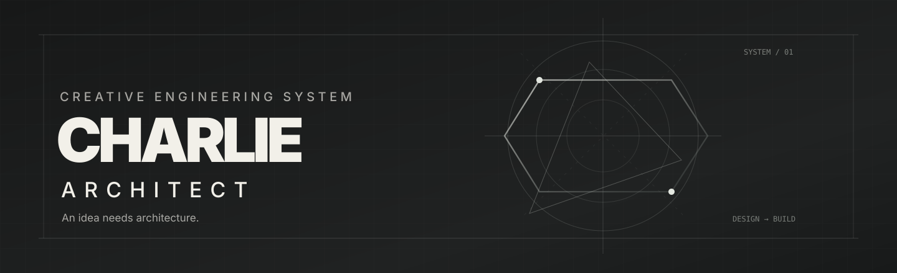

<div align="center">

### Design with intention. Build with precision.

**A creative engineering system for AI coding assistants.**  
Art direction, UX/UI, motion graphics, software architecture, full-stack development and quality — working as one.

[**Get started**](prompts/UNIVERSAL-START.md) · [**Explore the system**](AGENTS.md) · [**Documentation**](docs/) · [**Image-to-web**](prompts/IMAGE-REFERENCE-TEST.md)

**🌐 Official website:** *Public URL pending* · [Website project brief](prompts/BUILD-CHARLIE-WEBSITE.md)

</div>

---

### What makes Charlie different?

**Creative taste** — Bespoke design, not generic AI templates.  
**Motion craft** — Cinematic when it matters; responsive everywhere.  
**Production discipline** — Real functionality, accessible interactions and evidence-based QA.

### Get running

```bash
git clone https://github.com/julxx1/Charlie-Architect.git
cd Charlie-Architect
```

Open the folder in your preferred coding AI and ask:

> Read `AGENTS.md` and follow `prompts/UNIVERSAL-START.md` to build my project.

### Works with

**Claude Code** · **Cursor** · **Codex-compatible agents** · **GitHub Copilot** · **Gemini CLI** · Other assistants that can load project instructions.

[Setup by platform](integrations/README.md) · [Motion system](docs/MOTION-SYSTEM.md) · [Visual fidelity](docs/VISUAL-FIDELITY-STANDARD.md) · [Quality gates](docs/QUALITY-GATES.md)

---

<div align="center">
<sub>Open source · <a href="LICENSE">MIT License</a> · Charlie Architect is an instruction system, not a standalone AI model.</sub>
</div>
